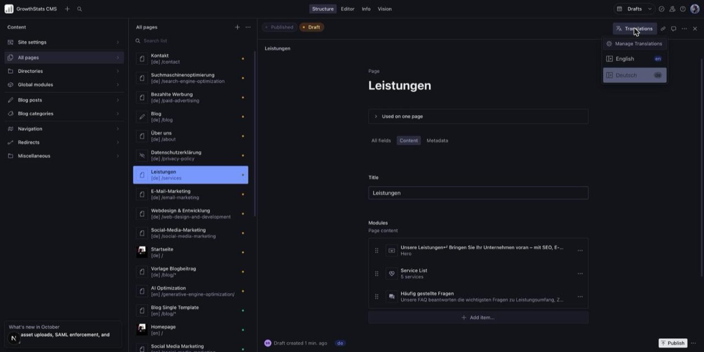
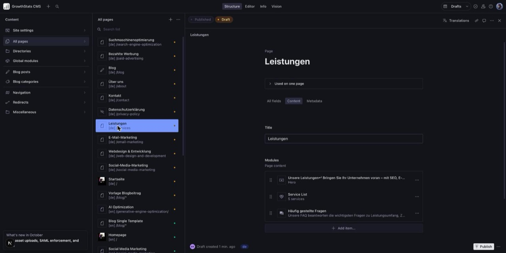
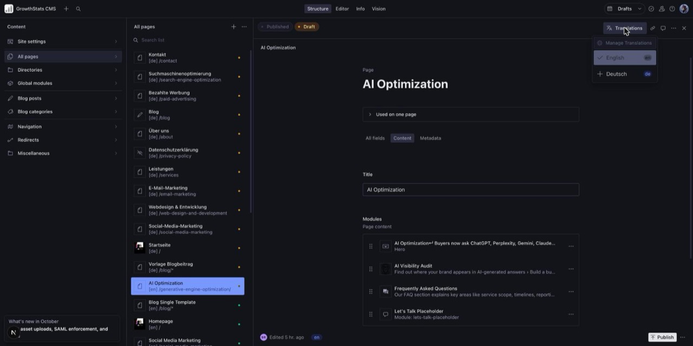
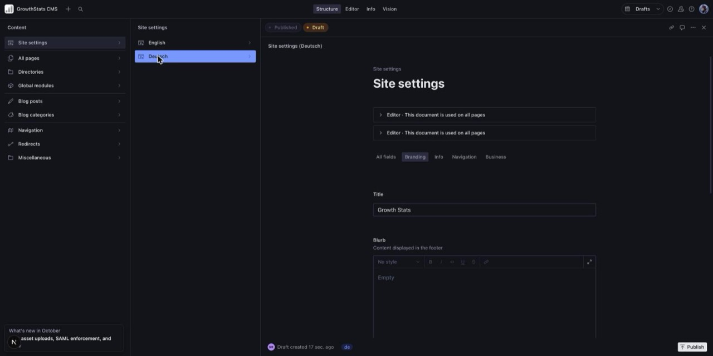

# Editing the German site

A guide for the Growth Stats team on looking after the German pages in the Studio (`/admin`). The developer notes are at the end.

## How German works

- **Every German page is its own document**, linked to its English page. Changing one doesn't change the other.
- **German addresses start with `/de/`** and keep the English ending: the German Services page is `/de/services`, not `/de/leistungen`.
- **German pages begin as drafts.** An AI drafts each German translation and saves it in the Studio without publishing it. Nothing appears on the live site until someone at Growth Stats proofreads the draft and publishes it.
- **If a page has no published German version, German visitors see the English page** with German menus and buttons around it. More on this [below](#pages-without-a-german-version).

The same applies to blog posts, blog categories, testimonials, menus, the blog's global module and the site settings.

## Finding a page's German version

In **All pages** (or **Blog posts**, **Navigation** and so on), each document's subtitle starts with its language: `[en]` or `[de]`. German pages have German titles, so the German Services page is **Leistungen**, with `[de] /services` underneath.

The dot on the right shows the status:

- **orange**: there are changes that aren't published yet (a draft)
- **green**: published, with no unpublished changes

![The All pages list. German drafts show [de] and an orange dot; published English pages show [en] and a green dot.](images/all-pages.jpg)

You can also open any page and click **Translations** at the top right. The menu lists every language. Click one to jump to that version. A tick marks the language you're looking at.



The **Search list** box at the top of each list also works with German titles.

## Proofreading a draft

1. Open the German draft. The **Draft** label at the top and the `de` badge at the bottom confirm that you're editing the German draft.
2. Read every field: the **Content** tab (title and every module on the page) and the **Metadata** tab (the page title and description Google shows).
3. Fix the text where it is. Your edits save automatically as you type, but stay in the draft until you publish.



What to check:

- **It reads like it was written in German.** The AI was told to write as a German marketing copywriter would, in formal "Sie", in Growth Stats' tone. Rewrite anything that sounds translated.
- **Names stay as they are.** Growth Stats, people's names, client names and tool names (Google, Meta, HubSpot) should not be translated.
- **Bold and linked words still make sense.** When part of a sentence is bold or a link, the AI translated that part separately. Check that the right words are bold or linked.
- **Search texts are not too long.** Under **Metadata**, keep the title under about 60 characters and the description under about 160.
- **Long German words fit.** German words can be much longer than English ones. If a button or heading looks too long, a shorter word is usually the best fix.

Don't change:

- **The address (slug).** A German page keeps the English address, so `/de/services` keeps `services`. Changing it breaks the link between the languages.
- **Images, links and settings** such as colours and layout. They are copied from the English page and should match it.

## Publishing

When a draft has been proofread, click **Publish** at the bottom right. The German page appears on the site shortly afterwards, as long as German is switched on for the site (see [German launch](#before-the-german-launch)).

To take a German page off the site again, use the **⋯** menu next to **Publish** and choose **Unpublish**. German visitors then get the English page again.

## Pages without a German version

If a page has no **published** German version (it was never translated, or the German draft isn't published yet), German visitors still get a page at `/de/...`. It shows:

- the **English** content of the page,
- with the **German** menus, footer and buttons around it.

Google is told that the English page is the real one, so the untranslated copy doesn't compete with it in search results. Once you publish the German version, it takes over the `/de/` address on its own.

The same goes for everything else: a missing German menu shows the English menu, and missing German site settings use the English ones.

## Adding a new page in both languages

1. Create and publish the English page as usual.
2. Choose one of these:
   - **Translate it yourself.** On the English page, click **Translations**, then **+ Deutsch**. The Studio makes a German copy of the page, still in English, as a new draft and opens it. Translate the text, then publish.
   - **Ask a developer for an AI draft.** They run the translation for that one page, and it appears as a German draft for you to proofread and publish, as above.



Until the German version is published, German visitors see the English page, as described above.

### Changing an English page that already has a German version

The German page doesn't update when you change the English one. After you change the English page, make the same change on the German page (open it with **Translations › Deutsch**) and publish both.

For a large rewrite, ask a developer for a fresh AI draft of the German page. That replaces the German draft completely, so only ask before anyone has started proofreading it, or once the edits made so far are published.

## German menus

Menus are under **Navigation**. The header and footer menus have German versions: **Header-Menü** and **Footer-Menü**. The social links (**Social-Media-Links**) are icons and web addresses, and the site uses the English **Social Links** in every language for now, so editing the German one has no effect.

![The Navigation list with the German menus (marked [de]) above the English ones (marked [en]).](images/navigation.jpg)

Edit and publish a German menu the same way as a page.

- **Menu labels** are what you translate.
- **Links** point at pages. Pick the English page, as in the English menu; German visitors are taken to its German version.
- If you add a link to the English menu, add it to the German menu too.

## German site settings

Open **Site settings › Deutsch**. This is where the German site title and footer text (**Branding**), the announcements and copyright line (**Info**) and the header buttons (**Navigation**) live.



- German site settings have no **Translations** menu. Switch between them using **English** and **Deutsch** in the **Site settings** list.
- The business details on the **Business** tab (address, phone, email, opening hours, map location) always come from the **English** settings, so they can't differ between languages. Change them there; editing them in German has no effect.
- The German settings point at the same menus as the English settings; the site picks the German version of each menu automatically.

## Before the German launch

Until German is switched on, the live site has no `/de/` pages, even for German pages that are already published. That lets you proofread and publish German pages one by one before visitors can see any of them.

Two parts are still being finished before launch: menu links that take German visitors to the German page ([#88](https://github.com/growthstats/gs-portfolio/issues/88)), and telling Google about untranslated pages ([#68](https://github.com/growthstats/gs-portfolio/issues/68)). Until then, links in German menus go to the English pages.

German is switched on once proofreading is done (issue [#74](https://github.com/growthstats/gs-portfolio/issues/74)). Tell a developer when everything is ready.

## Asking for a new language

Adding a language such as French is a small job for a developer, followed by the same proofreading as German. To request one, send a developer:

- the language,
- who will proofread it (a native speaker),
- which pages to translate first, if not all of them.

They add the language to the Studio, translate the site's built-in texts (buttons, form labels, error messages) and create AI drafts of the pages for the proofreader. Once those are proofread and published, they switch the language on.

## For developers

German drafts come from the translation pipeline in `scripts/i18n/`. [`scripts/i18n/README.md`](../../scripts/i18n/README.md) has the full instructions and the rules for translating a file. [ADR 0002](../adr/0002-translated-content-model.md) and [ADR 0003](../adr/0003-ui-strings-and-translation-pipeline.md) explain the design.

Use the Node version in `.nvmrc`. The scripts write to the dataset in `.env` with `SANITY_API_WRITE_TOKEN`, and never publish.

**New English content** (a page, post, category, menu and so on): export it, translate the file, then import it as a draft.

```bash
npm run i18n:export -- --lang de --id <english-document-id>
# translate i18n-work/de/<type>/<id>.json, following scripts/i18n/README.md
npm run i18n:import -- --lang de --id <english-document-id> --dry-run
npm run i18n:import -- --lang de --id <english-document-id>
```

**Changed English content:** the import rebuilds the German draft from the current English document and replaces the existing draft, including any proofreading edits in it. Check with the editors first:

- Small change, or proofreading already started: let the editors make the change by hand in the German document.
- Large rewrite and no proofreading yet: re-export with `--force`, translate, and import as above.

**Checking drafts locally:** set `NEXT_PUBLIC_ENABLED_LANGUAGES=en,de` in `.env` and run `npm run dev`. Dev reads drafts, so unpublished German pages show under `/de/`. A page that works locally may not be published yet.

**A new language:** add it to `LANGUAGES` in `src/lib/i18n.ts` and add `src/i18n/dictionaries/<lang>.ts` (TypeScript flags missing keys). Then run the pipeline with `--lang <code>`, and once the content is proofread, add the code to `NEXT_PUBLIC_ENABLED_LANGUAGES` in Vercel.
